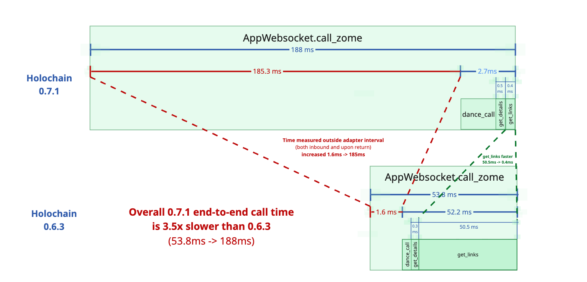

# Holochain invocation overhead and link-read findings

MAP Holons is a Holochain-based system for storing and browsing a graph of
self-describing objects, called holons. Its native Rust/Tauri client calls
coordinator zomes through `AppWebsocket.call_zome()`. The coordinator's MAP
`dance_adapter` entrypoint hydrates an application transaction context from
session-state wire objects, dispatches an operation (a MAP “Dance”), and prepares
the response and updated session state. The Space Navigator UI makes these
calls while displaying objects and following their relationships.

After upgrading from **Holochain 0.6.3 to 0.7.1**, we observed substantially
slower application startup and relationship navigation, despite dramatically
faster isolated HDK link reads. We therefore ran matched diagnostics to
separate time inside HDK retrieval, time inside our adapter, and the complete
authenticated client-to-guest round trip. The measured requests are read-only
application operations against an already bootstrapped database; bootstrap
itself is outside the reported request timings. These diagnostics isolate
individual calls, not an entire UI navigation.

**Request for the Holochain team:** help identify instrumentation that separates
invocation preparation before our measured adapter interval from return
processing after it, and attributes the increased time to specific stages.
We know the combined duration of those two portions; their split and cause
remain unmeasured.

## Main finding

**The leading regression is in the time surrounding the measured MAP guest
adapter interval.** In matched Holochain 0.6.3 and 0.7.1 tests, that time rose
from **1.587 ms to 185.049 ms** for an authenticated DescribedBy relationship
read, approximately **117×**. It overwhelmed a **126× improvement in the nested
HDK `get_links` call**, making the complete authenticated call **3.5× slower**.
A holon-fetch test reproduced the same pattern.

The diagram is schematic: red combines time before and after the measured
adapter interval; their split is unknown. Its 185.3 ms label subtracts rounded
component medians. Use the table's per-request paired residual median,
185.049 ms, for the reported overhead comparison.

Conductor-mediated host/guest invocation overhead is the leading hypothesis.
The residual also includes some unmeasured guest and client work; these timings
do not yet assign the delay to a specific Holochain component.

Measured October 20–21, 2026, during the DAHN performance investigation. These
are controlled screening results, not runtime contracts or production latency
percentiles. They extend the [Issue 816 findings](issue-816-findings.md).

## Latest matched authenticated-call comparison

Both versions used macOS arm64, **Rust 1.95.0**, native development
`opt-level="z"`, and release guest WASM with `opt-level="z"`, LTO, and one codegen
unit. MAP shared code and schema inputs were unchanged between the pre-upgrade
base (`87cb8349`) and the upgrade merge (`9bf273a7`); required Holochain
client/dependency/API adaptations were retained. Diagnostic and adapter timing
source were identical across versions.

Each version used a fresh single-agent SweetConductor and full Core Schema
bootstrap, live local rendezvous, full storage authority, and disabled
publishing/gossip. Runs were sequential after builds finished. Each run made
five authenticated `get_holon_by_id` requests followed by five authenticated
`query_relationships` requests for `HolonSpace.HolonType / DescribedBy`.
All five samples per operation are included. Direct Dance requests bypassed
host saved-cache shortcuts. Every relationship result matched the expected
target ID. Both tests and artifact audits passed.

Median milliseconds from this single matched experiment:

| Measurement | Holon fetch 0.6.3 | Holon fetch 0.7.1 | DescribedBy 0.6.3 | DescribedBy 0.7.1 |
|---|---:|---:|---:|---:|
| Complete authenticated call | **2.506** | **102.880** | **53.824** | **188.040** |
| Measured MAP adapter interval | 1.087 | 0.957 | 52.237 | 2.719 |
| HDK `get_details`, within dispatch | 0.292 | 0.298 | 0.317 | 0.487 |
| HDK `get_links`, within dispatch | 0.000 | 0.000 | 50.488 | 0.400 |
| Outside measured adapter interval | **1.357** | **101.975** | **1.587** | **185.049** |
| Wider client operation, including session handling | 2.561 | 102.945 | 53.886 | 188.117 |

Rows are nested measurements, not additive costs. Residual values are medians
of per-request complete-call minus adapter-interval durations; component
medians need not sum. Each holon fetch performed exactly one `get_details`.
Each relationship request performed exactly one source-holon `get_details`
for its accessibility check and one `get_links`, returning one target reference.
It did not fetch the target holon's property body.

The adapter improved because it includes the wait inside `get_links`; unchanged
MAP code does not imply unchanged elapsed time for that interval. The extra
0.170 ms in the relationship request's `get_details` is negligible against the
increase in the surrounding interval. Five samples do not establish a stable
percentage change in `get_details` performance.

[Aggregate at matching call boundaries](evidence/2026-10-holochain-matched-comparison/authenticated-read-summary.csv),
[every sample and provenance](evidence/2026-10-holochain-matched-comparison/authenticated-reads.json),
and [reproduction details](evidence/2026-10-holochain-matched-comparison/README.md)
support this table. Only the final matched capture for each experiment is
included in the published evidence; exploratory runs remain in the local archive.

## Timing boundaries and call paths

There are two distinct boundaries: client/conductor/WASM invocation, and HDK
retrieval inside the running guest. Both `get_links` and `get_details` cross
from guest WASM into Holochain's native runtime. Their timings include that
crossing and retrieval, not just SQL execution.

### Authenticated read

    Native client encodes the MAP envelope
      START COMPLETE-CALL TIMER: AppWebsocket.call_zome(...)
        → Signing, websocket request, conductor invocation preparation
        → Generated guest argument deserialization
          START MEASURED ADAPTER INTERVAL inside dance_adapter
            → Validate request, hydrate session context, bind request
            → Dispatch:
                Holon fetch: HDK get_details → decode MAP holon
                Relationship read: source get_details → HDK get_links
                                   → construct target reference
              Each HDK call has its own nested retrieval timer
            → Project response into wire objects, export session state
          STOP MEASURED ADAPTER INTERVAL
        → Profiling/final logging, return construction, local destruction
        → Generated response serialization and conductor response handling
      ← Websocket response arrives; STOP COMPLETE-CALL TIMER
    Native client decodes the MAP envelope and recovers session state

The adapter interval starts shortly after entering `dance_adapter` and ends
after session export, before final logging and return. It is **not the entire
WASM invocation**. It includes session context hydration and projection into
session-state wire objects, but not generated guest byte deserialization or
serialization. External client envelope encoding/decoding and session recovery
are outside the complete-call timer; they are included in the separately timed
wider client operation. The small difference between these outer timers does
not account for the measured regression in this workload.

### Repeated HDK link-read benchmark

    Native test harness → SweetConductor invokes the isolated test zome once
      → Guest prepares a relationship query
      → Repeat hundreds of times:
          START HDK TIMER
          get_links → WASM/native crossing → Holochain retrieval → guest result
          STOP HDK TIMER
      → Return all measurements → test invocation completes

This benchmark uses SweetConductor directly, without the authenticated app
websocket path. It excludes query construction, result comparison, and the
outer invocation from each HDK sample. `get_links` returns link metadata,
including target hashes, not target holon property bodies. These inner measurements cannot
be used as complete authenticated-call timings.

## Matched link-read repeat

With the same Rust 1.95.0 compiler and aligned build/conductor settings on both
versions, 200 repeated samples per condition confirmed the HDK retrieval gain.
First observations were retained separately and excluded from statistics; they
are not guaranteed cold-cache reads. Default and Local alternated order, then
Local was repeated. All strategies returned identical links.

| Relationship bucket | Default 0.6.3 | Default 0.7.1 | Median speedup |
|---|---:|---:|---:|
| DescribedBy: 1 link | 29.974 ms | 0.161 ms | 186× |
| Extends: 1 link | 29.890 ms | 0.157 ms | 190× |
| UsedByVisualizerUsage: empty | 40.415 ms | 0.144 ms | 282× |

Local medians were nearly identical to default. The empty Local host-call
control measured 40.491 ms versus 0.137 ms. Clock and `sys_time` controls
remained in microseconds. These repeated probe samples and the five
application-level requests above are different captures; their absolute HDK
latencies should not be mixed into one additive profile. No native SQL control
was repeated in this matched run.

[Strategy statistics](evidence/2026-10-holochain-matched-comparison/link-read-summary.csv),
[host-call controls](evidence/2026-10-holochain-matched-comparison/link-host-controls.csv),
and [provenance](evidence/2026-10-holochain-matched-comparison/link-read-metadata.json)
accompany the raw [0.6 samples](evidence/2026-10-holochain-matched-comparison/link-read-hc06.json)
and [0.7 samples](evidence/2026-10-holochain-matched-comparison/link-read-hc07.json).

## Interpretation and next target

The measured regression concerns the **outer invocation path surrounding our
adapter interval**, while HDK link retrieval improved substantially. “Outside
the adapter” does not mean “outside Holochain”: it includes conductor and WASM
invocation work. It also does not exclude all MAP guest work, since logging,
local destruction, and generated guest serialization remain outside our timer.

The next profiling target is the client/conductor/WASM path before and after
that interval: request handling and scheduling, invocation/WASM setup, guest
entry/exit serialization and cleanup, and response handling. Measure those
stages before assigning a cause. Use further independent runs to assess
variability; five calls on one fresh conductor per version are directional
evidence, not production percentile estimates. Required version-specific
client and dependency changes remain part of the upgrade comparison.
